# KotlinQuest · learn Kotlin the Duolingo way

[](https://github.com/gayatripatel10091992/kotlin-quest/actions/workflows/ci.yml)


A gamified Android app that teaches **Kotlin itself**: bite-sized lessons on a winding path, hearts, streaks with
freezes, XP and a daily goal, plus **spaced-repetition review** that brings back what you got wrong.

The course follows the features Android teams give as their reasons for adopting Kotlin: **null safety**,
**data and sealed classes**, **collections and lambdas**, and **coroutines and Flow**. Finishing a unit unlocks short
*Kotlin in production* cards on teams like Swiggy, Netflix, Airbnb and Duolingo.

> Portfolio project, all original code. The case-study cards are short summaries of public reporting
> (InfoStride, *Apps built with Kotlin*). They aren't statements from the companies, and no logos are used.

## Screenshots

Rendered in CI on every push by Robolectric + Roborazzi, from real `core` state rather than hand-made mock data.

| Learning path | Spot the bug | Build the line | Not quite | Fill the gap (dark) |
|---|---|---|---|---|
| 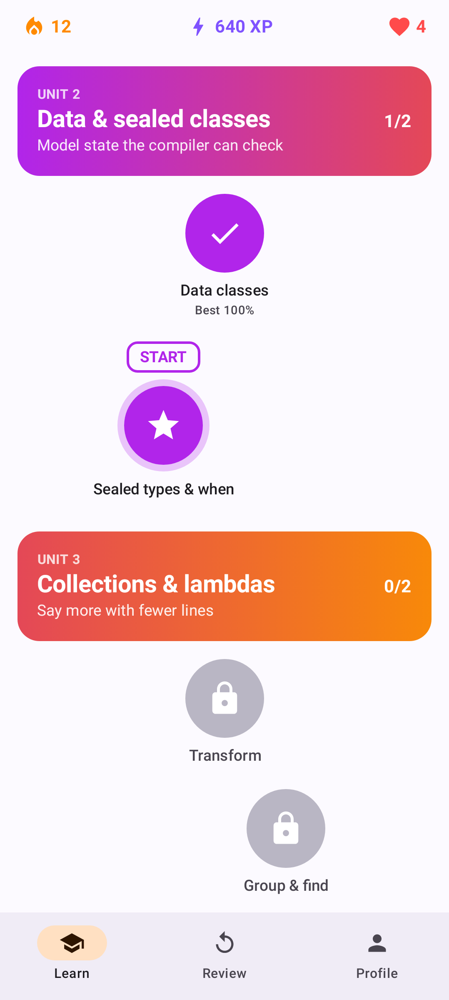 | 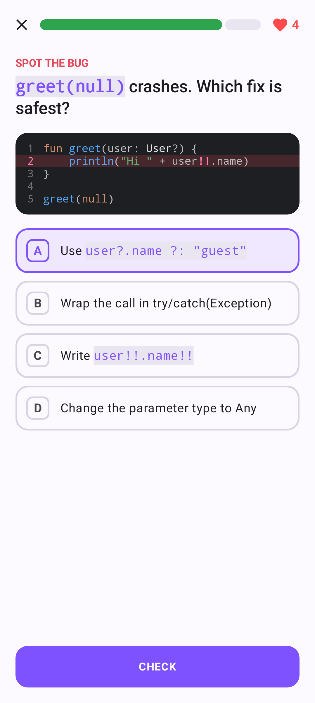 | 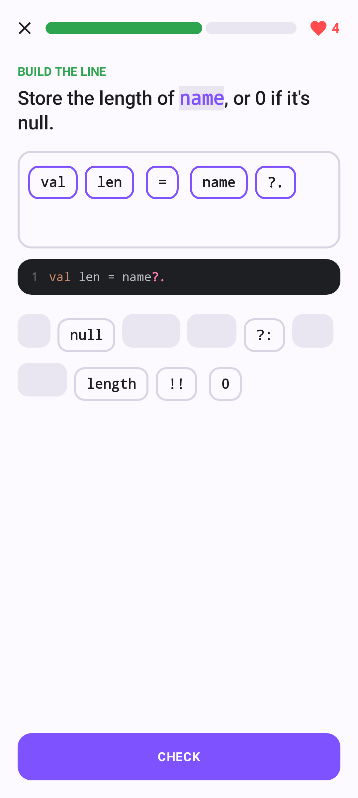 | 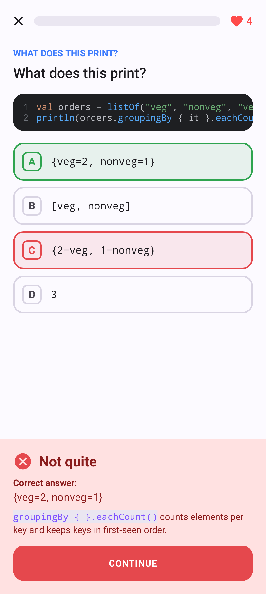 | 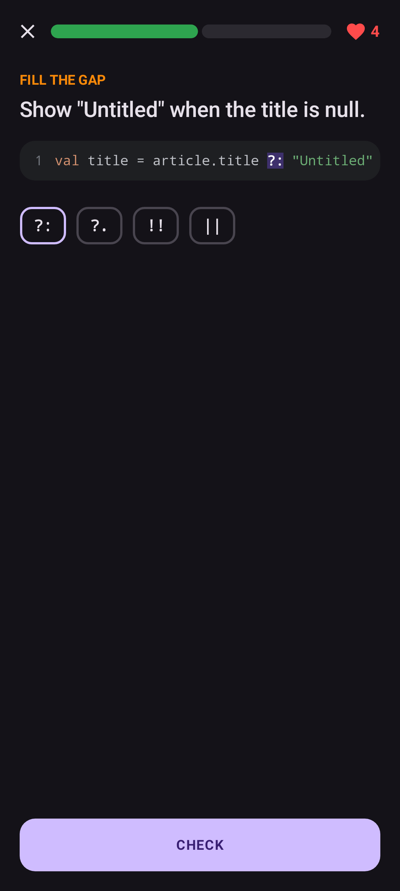 |

| Combo | Lesson complete | Out of hearts | Review deck | Profile |
|---|---|---|---|---|
| 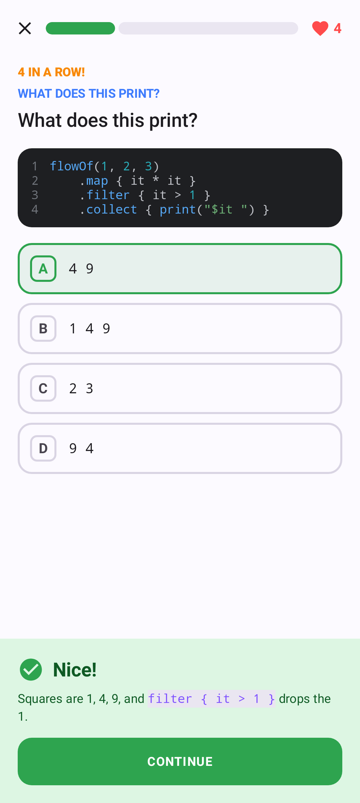 | 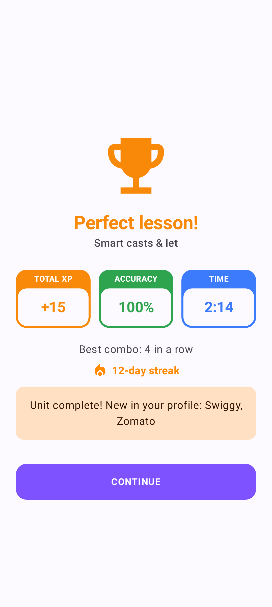 | 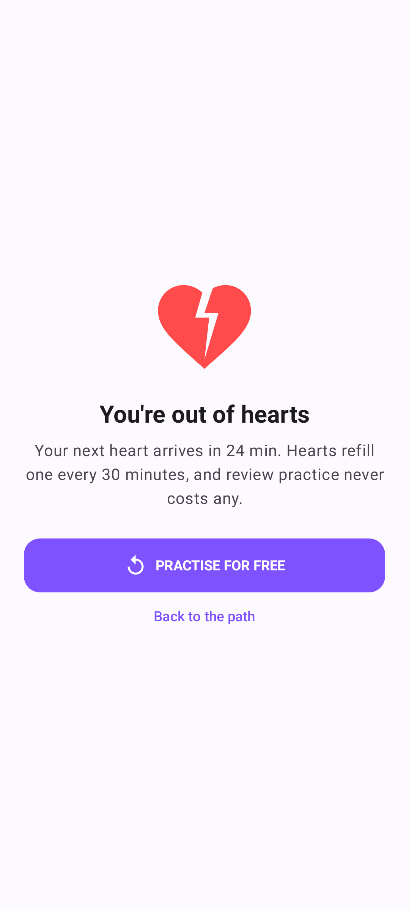 | 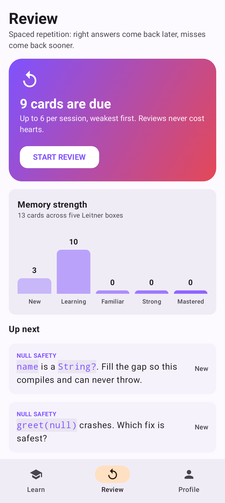 | 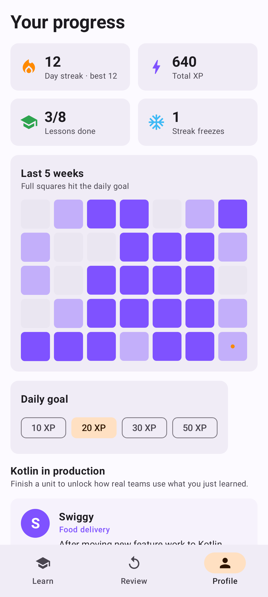 |

## What's inside

| Area | What's in the code |
|---|---|
| **Four exercise types** | `Choice` covers three kinds (concept, *what does this print?*, *spot the bug* with the faulty line marked), plus `FillBlank` (one `___` gap, with the chosen token shown in place) and `ArrangeTokens`, a code word bank. Picks are stored as bank indexes, so a line with two `.` tokens still works. `CodeFormat` joins tokens the way you'd type them: `items.sumOf { it.price }`. |
| **Lesson engine** | `LessonSession` is a pure state machine (answer → feedback → continue). A miss costs a heart and the exercise goes to the back of the queue, so you finish only once you've got everything right. It also tracks combos, perfect-lesson bonus XP and accuracy. |
| **Hearts without a timer** | `Hearts` stores only a count and an anchor time. Refills (one every 30 min) are worked out from the clock when read, so no WorkManager job or alarm is needed and the countdown can't drift. |
| **Streaks** | `Streak` uses local calendar days and earns a freeze every 7 days (max 2). A freeze covers one missed day; *at risk* shows when today's lesson is still to do. |
| **Spaced repetition** | `Leitner`: five boxes with 1-, 2-, 4-, 8- and 16-day intervals. Finishing a lesson seeds the deck (misses start in box 1, first-try answers in box 2). Reviews update cards one by one and never cost hearts, so an out-of-hearts learner can still practise. |
| **Syntax highlighting** | `KotlinHighlighter` is a home-made single-pass lexer for keywords, strings, numbers, comments, types, calls, annotations, and `?.` `?:` `!!` in their own colour. The code cards use it with line numbers and horizontal scroll. |
| **MVI** | `MviViewModel` takes intents and reduces them into one immutable `LessonUiState`, in the spirit of Airbnb's Mavericks. Every screen is a stateless composable, which is what makes the screenshot tests possible. |
| **Persistence** | All progress is one `ProgressCodec` string in Preferences DataStore, so each update is a single atomic transaction. The codec fails soft: a bad line is skipped instead of crashing, and unknown keys are ignored for forward compatibility. |
| **Tests** | 32 JVM tests in `:core` (grading, sessions, hearts, streaks, Leitner, codec, highlighter, content validity) and 11 Roborazzi screenshot tests in `:app`. |

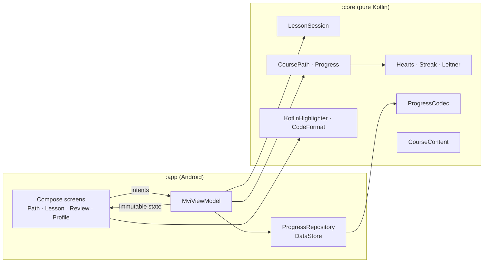

## The course

| Unit | Lessons | Unlocks |
|---|---|---|
| 1 · Null safety | Nullable types · Smart casts & let | Swiggy, Zomato |
| 2 · Data & sealed classes | Data classes · Sealed types & when | Airbnb, Duolingo |
| 3 · Collections & lambdas | Transform · Group & find | Pinterest, Basecamp 3, Square |
| 4 · Coroutines & Flow | Coroutines · Flow | Netflix, Uber |

Content lives in `CourseContent.kt` as plain Kotlin, and a unit test checks every exercise: unique ids, a valid
answer index, one gap per fill-in, and no word-bank distractor that also appears in the solution.

## Build

```bash
./gradlew :core:test                 # pure-Kotlin logic tests
./gradlew :app:recordRoborazziDebug  # regenerate screenshots into app/build/outputs/roborazzi
./gradlew assembleDebug              # app/build/outputs/apk/debug/app-debug.apk
```

Requires JDK 17. CI builds debug and minified release APKs on every push and uploads them as artifacts.

## Stack

Kotlin 2.1 · Jetpack Compose (Material 3) · Navigation Compose · ViewModel + StateFlow · Coroutines ·
Preferences DataStore · Koin · JUnit 4 · Robolectric · Roborazzi · GitHub Actions

---

Built by [Gayatri Patel](https://github.com/gayatripatel10091992), Senior Android Engineer.
